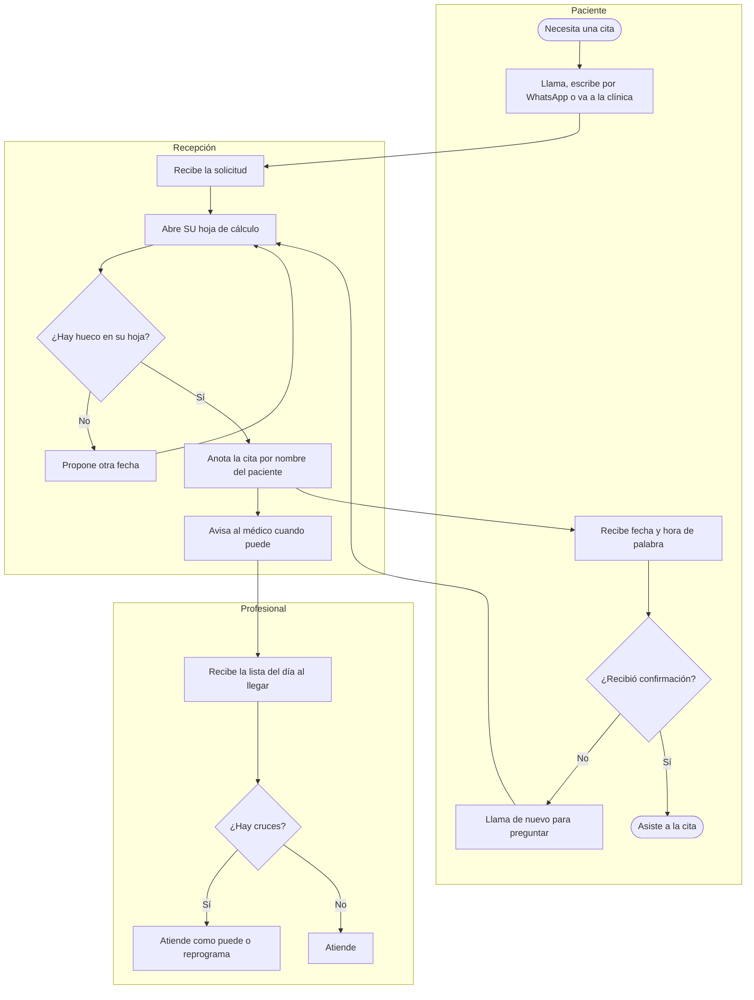
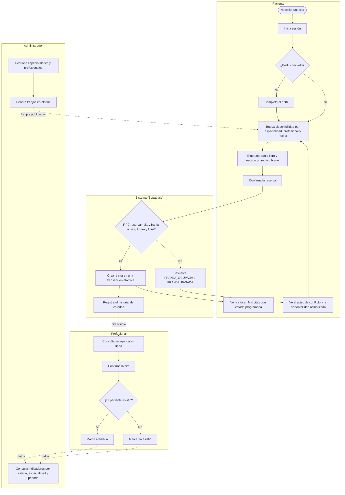
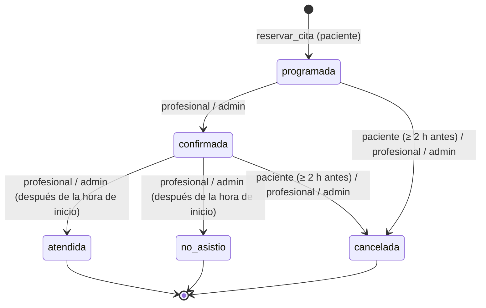

# 3. Modelo del proceso: AS IS y TO BE

Responde a la sección 6.1 del enunciado. Los diagramas son flujogramas tipo BPMN
simplificado escritos en **Mermaid**: GitHub los dibuja automáticamente al abrir este archivo.
Para el documento final se pueden exportar como imagen desde <https://mermaid.live>.

## 3.1 AS IS: proceso actual de asignación de citas

**Problemas visibles en el AS IS:**

1. **Paso A4:** cada recepcionista consulta una hoja distinta; dos pueden asignar la misma
   franja (causa C1, efecto E1).
2. **Paso A7:** el paciente se identifica por nombre; aparecen duplicados (C3, E2).
3. **Pasos A9–A11:** no hay confirmación escrita; el paciente vuelve a llamar (E3).
4. **Pasos A8 y M1:** el médico conoce su agenda tarde (C4, E4).
5. No hay estados ni historial: cancelaciones e inasistencias no se registran (C5, E5).

## 3.2 TO BE: proceso propuesto con el sistema

**Cómo el TO BE resuelve cada problema del AS IS:**

| Problema AS IS | Cambio en el TO BE | Mecanismo técnico |
| --- | --- | --- |
| Hojas de cálculo separadas (A4) | Una sola agenda en PostgreSQL. | Tablas `schedules` y `appointments`. |
| Doble asignación de franja | La base rechaza la segunda reserva. | Índice único parcial y RPC atómica `reservar_cita` (P2, P7 del plan). |
| Paciente identificado por nombre (A7) | Cada paciente tiene una cuenta y un documento. | `auth.users` + `profiles` enlazados por UUID. |
| Sin confirmación (A9–A11) | La cita aparece de inmediato en "Mis citas" con su estado. | Lectura de `appointments` filtrada por RLS. |
| Médico conoce la agenda tarde (A8, M1) | Agenda en línea, siempre actualizada. | RPC `mi_agenda`. |
| Sin estados ni historial | Estados cerrados con transiciones válidas e historial automático. | Tipo `estado_cita`, trigger y `status_history`. |
| Sin datos para decidir | Panel de indicadores. | RPC `indicadores_citas`. |

## 3.3 Subproceso: ciclo de vida de una cita

Diagrama de estados que resume la tabla de transiciones P6 del plan.

Al pasar a `cancelada`, la franja **se conserva** y vuelve a estar disponible porque ya no
tiene una cita activa.
