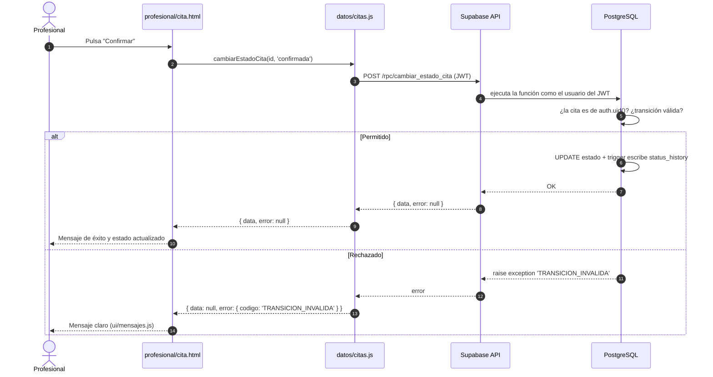

# Arquitectura de la solución

Responsable: P4 (apoyo de P2). Responde a la sección 8.1 del enunciado: arquitectura web
**cliente-nube**, diagrama y responsabilidad de cada componente.

## 1. Diagrama cliente-nube

GitHub renderiza este diagrama directamente (Mermaid). Para el documento final se puede

```mermaid
flowchart LR
    subgraph Usuario["Dispositivo del usuario"]
        direction TB
        Persona(["Paciente / Profesional / Admin"])
        subgraph Navegador["Navegador web"]
            direction TB
            Paginas["Páginas HTML + CSS<br/>index, paciente/, profesional/, admin/"]
            UI["assets/js/ui/ y auth.js<br/>mensajes, estados, guardas por rol"]
            Datos["assets/js/datos/<br/>citas, catalogos, perfiles, indicadores"]
            Cliente["cliente.js<br/>supabase-js 2.45.4"]
            Paginas --> UI --> Datos --> Cliente
        end
        Persona --> Paginas
    end

    subgraph GitHub["GitHub"]
        Repo[("Repositorio<br/>código, SQL y docs")]
        Pages["GitHub Pages<br/>hosting estático HTTPS"]
        Repo -- "publica la rama main" --> Pages
    end

    CDN["CDN jsDelivr<br/>supabase-js"]

    subgraph Supabase["Supabase (nube)"]
        direction TB
        Auth["Supabase Auth<br/>registro, sesión, JWT"]
        API["API REST automática<br/>PostgREST: tablas y /rpc"]
        subgraph PG["PostgreSQL"]
            direction TB
            RLS{{"Row Level Security<br/>+ permisos por columna"}}
            RPC["Funciones RPC<br/>reservar_cita, cambiar_estado_cita,<br/>mi_agenda, generar_franjas,<br/>asignar_rol, indicadores_citas..."]
            Trig["Triggers y restricciones<br/>transiciones, historial,<br/>índice único parcial, exclusión"]
            Tablas[("profiles, specialties,<br/>professionals, schedules,<br/>appointments, status_history")]
            RLS --> Tablas
            RPC --> Trig --> Tablas
        end
        Auth -- "auth.uid() en el JWT" --> API
        API --> RLS
        API --> RPC
    end

    Pages -- "1. descarga HTML, CSS, JS (HTTPS)" --> Navegador
    CDN -- "2. descarga la librería" --> Cliente
    Cliente -- "3. inicia sesión" --> Auth
    Cliente -- "4. consultas y RPC con<br/>clave anon + JWT del usuario" --> API
```

exportar como imagen desde <https://mermaid.live>.

### Flujo de una petición (ejemplo: el profesional confirma una cita)

## 2. Responsabilidad de cada componente

| Componente | Dónde está | Responsabilidad | Qué NO hace |
| --- | --- | --- | --- |
| **Páginas HTML + CSS** | `index.html`, `paciente/`, `profesional/`, `admin/`, `assets/css/` | Estructura semántica, formularios accesibles, diseño responsive (≥ 360 px). | No contienen lógica de negocio ni consultas. |
| **Interfaz y sesión** | `assets/js/auth.js`, `assets/js/ui/`, `assets/js/validacion.js` | Iniciar y cerrar sesión, redirigir según el rol, detectar sesión vencida, validar formularios, mostrar estados (cargando, vacío, error, acceso denegado, éxito) y traducir códigos de error a mensajes. Pinta datos solo con `textContent` y `createElement`. | No autoriza: ocultar un botón es usabilidad, no seguridad. |
| **Capa de acceso a datos** | `assets/js/datos/` | Un módulo por recurso que envuelve las llamadas del contrato (`docs/contrato_api.md`) y devuelve siempre `{ data, error }` con el código de error del contrato. Es el único lugar que conoce nombres de tablas y RPC. | No decide permisos: solo pide; la base responde. |
| **Cliente Supabase** | `assets/js/datos/cliente.js`, `assets/js/config.js` | Crea una sola instancia de `supabase-js` con la URL y la clave **anon** (pública por diseño). Guarda y renueva el JWT de la sesión. | Nunca usa la `service_role`. |
| **GitHub (repositorio)** | github.com | Versiona código, SQL y documentación; Pull Requests con revisión cruzada; historial de commits de todos los integrantes. | — |
| **GitHub Pages** | `https://<usuario>.github.io/diseno/` | Sirve los archivos estáticos por HTTPS. | No ejecuta código del servidor ni guarda secretos: todo lo que publica es visible. |
| **CDN jsDelivr** | cdn.jsdelivr.net | Entrega `supabase-js` con versión fijada (2.45.4), sin Node ni empaquetadores. | — |
| **Supabase Auth** | Supabase | Registro, inicio de sesión, recuperación de contraseña y emisión del JWT con el `auth.uid()` del usuario. | No asigna roles: el perfil nace como `paciente` por un trigger. |
| **API REST (PostgREST)** | Supabase | Expone tablas y funciones RPC por HTTP; ejecuta cada petición con la identidad del JWT. | No salta la RLS cuando se usa la clave anon. |
| **Row Level Security y permisos** | `sql/politicas_rls.sql` | Decide qué filas ve cada rol (el paciente solo sus citas, el profesional solo las asignadas) y qué columnas puede tocar (nadie se cambia el rol). | — |
| **Funciones RPC** | `sql/esquema.sql` | Única vía de escritura de citas: validan quién llama, el plazo de cancelación, la hora de inicio y el formato. Devuelven códigos de error del contrato. | — |
| **Triggers y restricciones** | `sql/esquema.sql` | Integridad que no depende del cliente: índice único parcial (sin doble reserva), exclusión de franjas superpuestas, transiciones de estado válidas, historial automático con `changed_by`. | — |

## 3. Decisiones de arquitectura y por qué

1. **Sin servidor propio.** El enunciado solo permite HTML, CSS, JS, GitHub Pages y Supabase.
   Por eso toda regla crítica vive en PostgreSQL (RLS, RPC, triggers) y el navegador se trata
   como un cliente **no confiable**: cualquier persona puede abrir la consola y llamar a la
   API directamente con la clave anon.
2. **Clave anon en el repositorio.** En un sitio estático no existe un `.env` privado: lo que
   llega al navegador es público. La clave anon solo permite lo que permiten las RLS; la
   `service_role` nunca sale de Supabase (corrección C3 del plan).
3. **Escrituras de citas solo por RPC.** Un `UPDATE` directo dejaría a un profesional cambiar
   `patient_id` o `schedule_id`. Las RPC limitan la operación a lo que el caso de uso permite
   (plan P7).
4. **Capa de datos separada.** Las páginas no llaman a `supabase.from(...)` directamente:
   llaman a `datos/*.js`. Si P2 cambia un nombre en el contrato, se corrige en un solo sitio.
   Cumple la sección 11.2 del enunciado: separar presentación, lógica de interfaz y acceso a
   datos.
5. **Indicadores agregados en la base.** El admin no descarga todas las citas para contarlas:
   la RPC `indicadores_citas` devuelve solo conteos (plan P11), con menos datos personales en
   tránsito y menos carga en el navegador.
6. **Zona horaria America/Bogota.** Las comparaciones de "pasado/futuro" y "2 horas antes" se
   hacen en la base con la hora de la clínica (corrección C8), no con el reloj del navegador.

## 4. Si hubiera varias sedes (pregunta de sustentación)

Se añadiría una tabla `sedes` y un `sede_id` en `schedules`. La arquitectura no cambia: la
restricción de exclusión sigue siendo por profesional, la RPC `franjas_disponibles` recibe un
filtro más y el panel admin agrega una pantalla de sedes.
