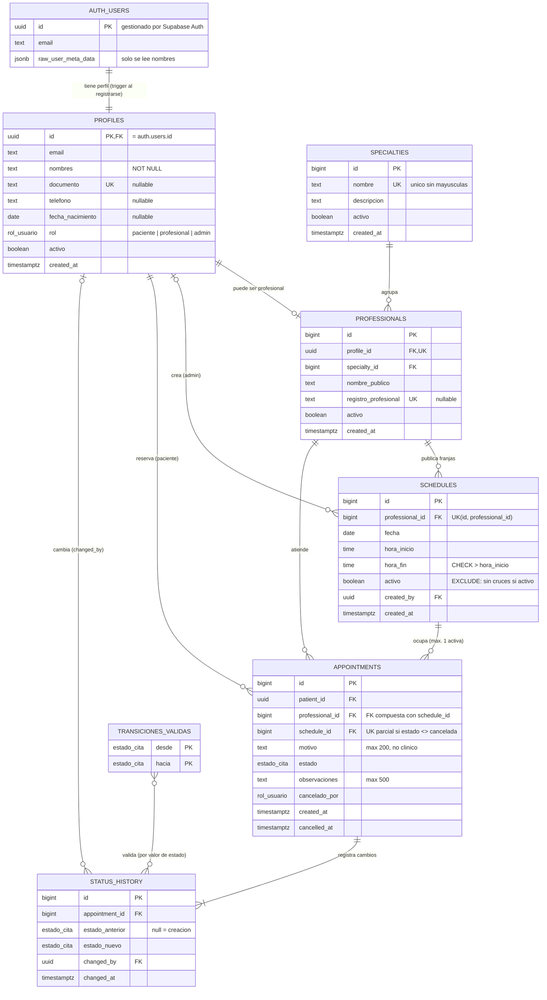

# Diagrama entidad-relación

Dueño: P2. Implementación: `sql/esquema.sql`. Detalle de cada columna en
[diccionario_datos.md](diccionario_datos.md).

GitHub muestra el diagrama Mermaid directamente. Para exportarlo como imagen al documento
final se puede pegar el bloque en <https://mermaid.live>.

## Cardinalidades y decisiones

| Relación | Cardinalidad | Decisión |
| --- | --- | --- |
| `auth.users` – `profiles` | 1 a 1 | Credenciales separadas de los datos públicos (sección 9.1). Mismo UUID. El trigger `trg_nuevo_usuario` crea el perfil, siempre como `paciente`. |
| `profiles` – `professionals` | 1 a 0..1 | Un usuario es profesional solo si un admin lo promueve con `asignar_rol`. `profile_id` es único. |
| `specialties` – `professionals` | 1 a N | Cada profesional tiene una especialidad (MVP). Varias especialidades por profesional quedan fuera del alcance. |
| `professionals` – `schedules` | 1 a N | Cada franja es concreta (C2). La restricción `ex_schedules_sin_cruce` impide franjas activas cruzadas del mismo profesional (P3). |
| `schedules` – `appointments` | 1 a N, **máximo 1 activa** | Una franja conserva el historial de citas canceladas, pero el índice único parcial `uq_franja_con_cita_activa` solo permite una cita no cancelada (P2). |
| `appointments` – `schedules` / `professionals` | FK compuesta | `(schedule_id, professional_id)` → `schedules(id, professional_id)`: la cita no puede apuntar a la franja de otro profesional (C7). |
| `appointments` – `status_history` | 1 a 1..N | El trigger `trg_historial_cita` escribe la creación y cada cambio de estado con `changed_by = auth.uid()`. |
| `transiciones_validas` | catálogo | No tiene FK hacia otras tablas: el trigger `trg_validar_cita` la consulta por valor (`desde`, `hacia`) para aceptar o rechazar cada cambio. |

## Normalización

- **1FN:** todos los atributos son atómicos (no hay listas en columnas).
- **2FN:** todas las tablas tienen clave primaria simple, salvo `transiciones_validas`, que
  no tiene atributos fuera de la clave.
- **3FN:** no hay dependencias transitivas, con **una redundancia controlada**:
  `appointments.professional_id` se puede deducir de `schedule_id`. Se conserva para filtrar
  rápido la agenda y para la RLS del profesional, y la FK compuesta garantiza que nunca sea
  inconsistente (C7). `professionals.nombre_publico` no es redundante con
  `profiles.nombres`: es el nombre que se muestra a los pacientes (ej. "Dra. Laura Gómez"),
  porque ellos no pueden leer perfiles ajenos (P9).
