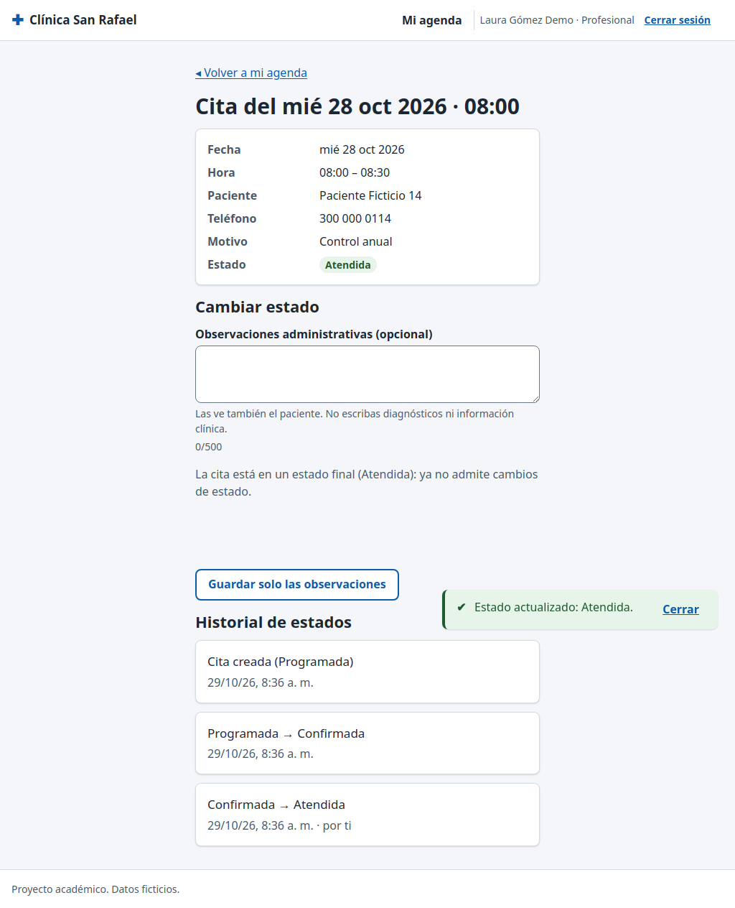

# CP-10: Una cita atendida no vuelve a programada

| Campo | Valor |
| --- | --- |
| Tipo | Regla de negocio |
| Requisito | RF-11 (enunciado 5.3) |
| Responsable | P4 |
| Datos usados | `profesional1@demo.test`; una cita propia `confirmada` cuya hora ya pasó. |
| Resultado esperado | La interfaz no ofrece la transición, y la base la rechaza con `TRANSICION_INVALIDA` si se fuerza. |
| Estado | **Aprobado en la réplica local.** Pendiente de repetir en la URL publicada contra Supabase. |

## Pasos

1. Entrar como profesional1 y abrir el detalle de la cita (`profesional/cita.html?id=…`).
2. Pulsar **Marcar atendida** y confirmar en el diálogo.
3. Comprobar que ya no aparece ningún botón de estado.
4. Desde la consola del navegador, saltando la interfaz: `(await import('/assets/js/datos/citas.js')).cambiarEstadoCita(id, 'programada')`.

## Resultado obtenido

| Comprobación | Resultado | Estado |
| --- | --- | --- |
| Antes: botones ofrecidos | "Marcar atendida", "Marcar no asistió", "Cancelar cita" | Pasa |
| Tras marcar atendida | estado `atendida`; historial con `changed_by` = profesional1 | Pasa |
| Botones en estado atendida | ninguno: "La cita está en un estado final (Atendida)" | Pasa |
| Llamada forzada atendida → programada | `{codigo: "TRANSICION_INVALIDA", code: "P0001", details: "No se permite pasar de atendida a programada."}` | Pasa |
| Estado en la base después | sigue `atendida` | Pasa |

## Captura

La captura muestra la cita ya atendida, sin botones de cambio y con el historial completo.

## Entorno de ejecución

- **Fecha:** 29/10/2026. **Ejecutó:** P4 (Claude Code, Claude Opus 5.5), con un script de
  Playwright que maneja un Chromium real y compara contra consultas SQL directas.
- **Dónde:** **réplica local**, no el proyecto Supabase. PostgreSQL 15 (Docker) con los scripts
  de P2 en orden (`sql/local/simular_supabase.sql`, `esquema.sql`, `politicas_rls.sql`,
  `sql/local/crear_cuentas_demo.sql`, `datos_prueba.sql` y `datos_pruebas_especiales.sql` de la
  rama `p2/ronda2`), **PostgREST v12.2.3** (la versión de la API de Supabase) y un servidor local
  que sirve las páginas del repositorio y simula Supabase Auth con JWT firmados localmente.
  Las páginas, `supabase-js 2.45.4`, la RLS y las RPC son las reales; lo único simulado es el
  inicio de sesión (sin contraseñas).
- **Por qué local:** P4 no tiene ni pide las contraseñas de las cuentas demo. **Pendiente
  (ronda 3):** repetir en `https://cospino08.github.io/diseno/` con las cuentas reales.
