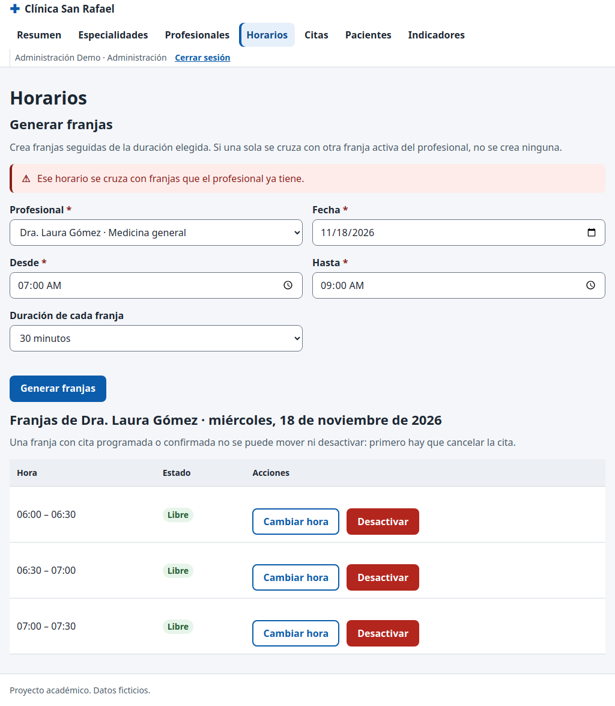

# CP-11: Franjas que se cruzan para el mismo profesional

| Campo | Valor |
| --- | --- |
| Tipo | Regla de negocio |
| Requisito | RF-16 (enunciado 5.3) |
| Responsable | P4 |
| Datos usados | `admin@demo.test`; profesional1; una fecha 20 días adelante. |
| Resultado esperado | `HORARIO_SUPERPUESTO`; no se crea ninguna franja nueva (todo o nada). |
| Estado | **Aprobado en la réplica local.** Pendiente de repetir en la URL publicada contra Supabase. |

## Pasos

1. En **Administración → Horarios**, generar franjas de 30 min de 06:00 a 07:30.
2. Con el mismo profesional y fecha, generar de 07:00 a 09:00 (se cruza con 07:00-07:30 y con las franjas de la mañana de los datos de prueba).
3. Contar en SQL las franjas del profesional ese día antes y después.

## Resultado obtenido

| Comprobación | Resultado | Estado |
| --- | --- | --- |
| Primer rango (06:00-07:30) | "Se crearon 3 franjas de 30 minutos"; +3 filas en `schedules` | Pasa |
| Segundo rango (07:00-09:00) | alerta "Ese horario se cruza con franjas que el profesional ya tiene." | Pasa |
| Franjas ese día tras el intento | igual que antes (3 → 3): no se creó ninguna | Pasa |
| Fecha pasada | el formulario la rechaza ("No se pueden crear franjas en fechas pasadas"); la base además daría `FRANJA_PASADA` | Pasa |

## Captura

## Entorno de ejecución

- **Fecha:** 29/10/2026. **Ejecutó:** P4 (Claude Code, Claude Opus 5.5), con un script de
  Playwright que maneja un Chromium real y compara contra consultas SQL directas.
- **Dónde:** **réplica local**, no el proyecto Supabase. PostgreSQL 15 (Docker) con los scripts
  de P2 en orden (`sql/local/simular_supabase.sql`, `esquema.sql`, `politicas_rls.sql`,
  `sql/local/crear_cuentas_demo.sql`, `datos_prueba.sql` y `datos_pruebas_especiales.sql` de la
  rama `p2/ronda2`), **PostgREST v12.2.3** (la versión de la API de Supabase) y un servidor local
  que sirve las páginas del repositorio y simula Supabase Auth con JWT firmados localmente.
  Las páginas, `supabase-js 2.45.4`, la RLS y las RPC son las reales; lo único simulado es el
  inicio de sesión (sin contraseñas).
- **Por qué local:** P4 no tiene ni pide las contraseñas de las cuentas demo. **Pendiente
  (ronda 3):** repetir en `https://cospino08.github.io/diseno/` con las cuentas reales.
