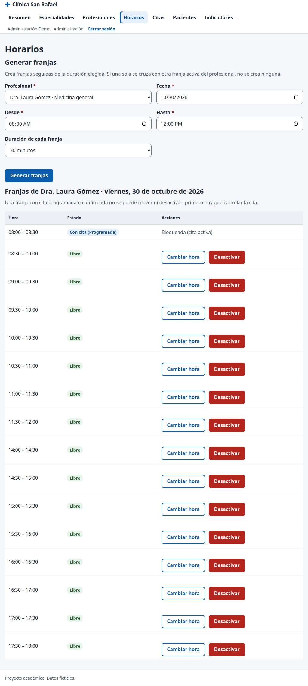

# CP-12: Mover o desactivar una franja con cita activa

| Campo | Valor |
| --- | --- |
| Tipo | Regla de negocio |
| Requisito | RF-17 (pregunta 6.2, plan P12) |
| Responsable | P4 |
| Datos usados | `admin@demo.test`; la primera franja futura de profesional1 con cita `programada` o `confirmada`. |
| Resultado esperado | `FRANJA_CON_CITA` en ambos casos; la franja no cambia. |
| Estado | **Aprobado en la réplica local.** Pendiente de repetir en la URL publicada contra Supabase. |

## Pasos

1. Abrir **Horarios** con ese profesional y fecha: la franja aparece como "Con cita" y "Bloqueada (cita activa)", sin botones.
2. Desde la consola (la interfaz no lo permite, pero la seguridad no puede depender de eso): `actualizarFranja(id, {fecha: '2030-01-01', horaInicio: '05:00', horaFin: '05:30'})` y `cambiarActivoFranja(id, false)` de `assets/js/datos/catalogos.js`.
3. Comparar en SQL la fila de la franja antes y después.

## Resultado obtenido

| Comprobación | Resultado | Estado |
| --- | --- | --- |
| Interfaz | franja marcada "Bloqueada (cita activa)", sin acciones | Pasa |
| Mover por consola | `{codigo: "FRANJA_CON_CITA", details: "La franja tiene una cita activa. Cancele la cita antes de modificarla."}` | Pasa |
| Desactivar por consola | `FRANJA_CON_CITA` | Pasa |
| Fila en la base | `2026-10-30 08:00:00 true` antes y después | Pasa |
| Control positivo: franja libre | se desactiva y se mueve a 05:30 sin error | Pasa |

## Captura

## Entorno de ejecución

- **Fecha:** 29/10/2026. **Ejecutó:** P4 (Claude Code, Claude Opus 5.5), con un script de
  Playwright que maneja un Chromium real y compara contra consultas SQL directas.
- **Dónde:** **réplica local**, no el proyecto Supabase. PostgreSQL 15 (Docker) con los scripts
  de P2 en orden (`sql/local/simular_supabase.sql`, `esquema.sql`, `politicas_rls.sql`,
  `sql/local/crear_cuentas_demo.sql`, `datos_prueba.sql` y `datos_pruebas_especiales.sql` de la
  rama `p2/ronda2`), **PostgREST v12.2.3** (la versión de la API de Supabase) y un servidor local
  que sirve las páginas del repositorio y simula Supabase Auth con JWT firmados localmente.
  Las páginas, `supabase-js 2.45.4`, la RLS y las RPC son las reales; lo único simulado es el
  inicio de sesión (sin contraseñas).
- **Por qué local:** P4 no tiene ni pide las contraseñas de las cuentas demo. **Pendiente
  (ronda 3):** repetir en `https://cospino08.github.io/diseno/` con las cuentas reales.
