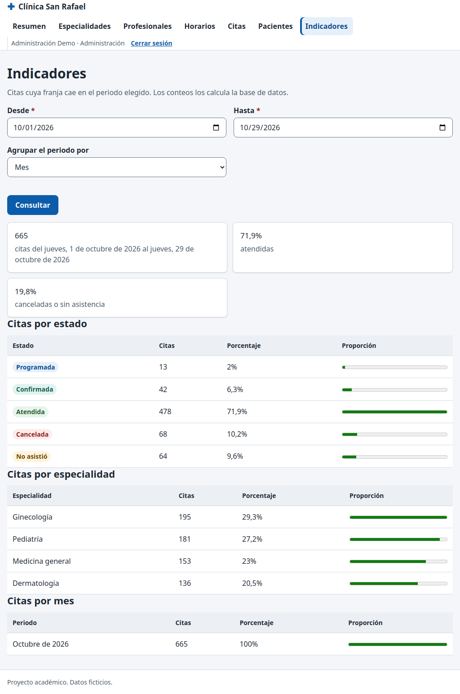

# CP-15: Los indicadores coinciden con conteos SQL

| Campo | Valor |
| --- | --- |
| Tipo | Funcional |
| Requisito | RF-19 |
| Responsable | P4 |
| Datos usados | `admin@demo.test`; periodo por defecto (del 1 de octubre de 2026 a hoy). |
| Resultado esperado | Totales por estado, especialidad y periodo iguales a la consulta SQL directa. |
| Estado | **Aprobado en la réplica local.** Pendiente de repetir en la URL publicada contra Supabase. |

## Pasos

1. Abrir **Administración → Indicadores** (agrupación por mes) y leer las tablas.
2. Contar en SQL las citas cuya franja cae en el mismo rango: total, `group by estado`, `group by especialidad` y `group by date_trunc('week', fecha)`.
3. Cambiar la agrupación a **Semana** y volver a comparar.

## Resultado obtenido

| Comprobación | Resultado | Estado |
| --- | --- | --- |
| Total | 665 en pantalla = 665 en SQL | Pasa |
| Por estado | Programada 13, Confirmada 42, Atendida 478, Cancelada 68, No asistió 64: iguales | Pasa |
| Por especialidad | Ginecología 195, Pediatría 181, Medicina general 153, Dermatología 136: iguales | Pasa |
| Por semana | 48, 224, 224, 169 (semanas del 5, 12, 19 y 26 de octubre): iguales | Pasa |
| Paciente llama a `indicadores_citas` | `NO_AUTORIZADO` | Pasa |

## Captura

Las cifras exactas dependen del día en que se cargan los datos de prueba (se generan relativos a la fecha actual) y de las acciones previas de la misma ejecución.

## Entorno de ejecución

- **Fecha:** 29/10/2026. **Ejecutó:** P4 (Claude Code, Claude Opus 5.5), con un script de
  Playwright que maneja un Chromium real y compara contra consultas SQL directas.
- **Dónde:** **réplica local**, no el proyecto Supabase. PostgreSQL 15 (Docker) con los scripts
  de P2 en orden (`sql/local/simular_supabase.sql`, `esquema.sql`, `politicas_rls.sql`,
  `sql/local/crear_cuentas_demo.sql`, `datos_prueba.sql` y `datos_pruebas_especiales.sql` de la
  rama `p2/ronda2`), **PostgREST v12.2.3** (la versión de la API de Supabase) y un servidor local
  que sirve las páginas del repositorio y simula Supabase Auth con JWT firmados localmente.
  Las páginas, `supabase-js 2.45.4`, la RLS y las RPC son las reales; lo único simulado es el
  inicio de sesión (sin contraseñas).
- **Por qué local:** P4 no tiene ni pide las contraseñas de las cuentas demo. **Pendiente
  (ronda 3):** repetir en `https://cospino08.github.io/diseno/` con las cuentas reales.
