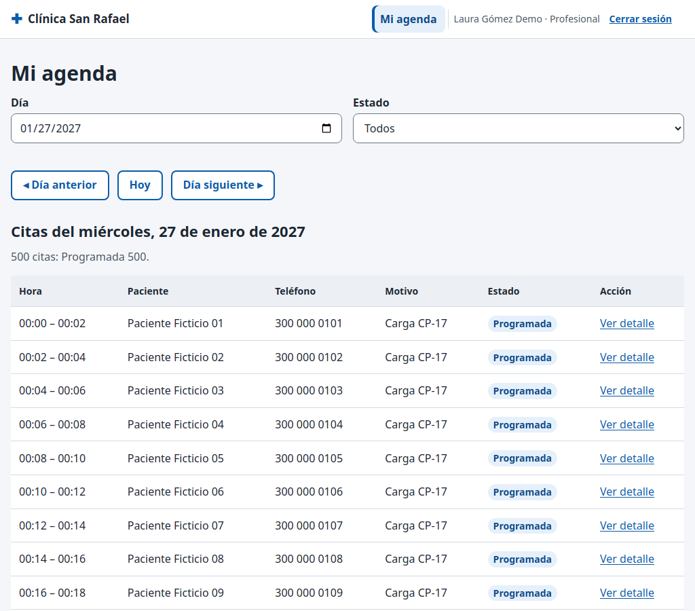

# CP-17: Agenda de un día con 500 citas

| Campo | Valor |
| --- | --- |
| Tipo | Rendimiento |
| Requisito | RNF-02, RF-10 |
| Responsable | P4 |
| Datos usados | `profesional1@demo.test`; el "día de carga" de `datos_pruebas_especiales.sql` (27/01/2027, 500 citas). |
| Resultado esperado | Carga en ≤ 3 s (promedio de 3 mediciones). |
| Estado | **Aprobado en la réplica local.** Pendiente de repetir en la URL publicada contra Supabase. |

## Pasos

1. Abrir `profesional/agenda.html?fecha=2027-01-27` tres veces.
2. Medir desde que se pide la página hasta que la tabla tiene las 500 filas pintadas.

## Resultado obtenido

| Comprobación | Resultado | Estado |
| --- | --- | --- |
| Mediciones | 0,44 s · 0,27 s · 0,35 s | Pasa |
| Promedio | **0,35 s** (límite: 3 s) | Pasa |
| Filas pintadas | 500 de 500 | Pasa |
| Solo la RPC `mi_agenda` | 12 ms para 500 filas | Informativo |

## Captura

**Limitación:** en la réplica local no hay latencia de red. En Supabase cada petición cruza internet, así que el tiempo real será mayor. Hay margen (0,35 s frente a 3 s), pero la cifra válida para el informe es la que se mida en la URL publicada.

## Entorno de ejecución

- **Fecha:** 29/10/2026. **Ejecutó:** P4 (Claude Code, Claude Opus 5.5), con un script de
  Playwright que maneja un Chromium real y compara contra consultas SQL directas.
- **Dónde:** **réplica local**, no el proyecto Supabase. PostgreSQL 15 (Docker) con los scripts
  de P2 en orden (`sql/local/simular_supabase.sql`, `esquema.sql`, `politicas_rls.sql`,
  `sql/local/crear_cuentas_demo.sql`, `datos_prueba.sql` y `datos_pruebas_especiales.sql` de la
  rama `p2/ronda2`), **PostgREST v12.2.3** (la versión de la API de Supabase) y un servidor local
  que sirve las páginas del repositorio y simula Supabase Auth con JWT firmados localmente.
  Las páginas, `supabase-js 2.45.4`, la RLS y las RPC son las reales; lo único simulado es el
  inicio de sesión (sin contraseñas).
- **Por qué local:** P4 no tiene ni pide las contraseñas de las cuentas demo. **Pendiente
  (ronda 3):** repetir en `https://cospino08.github.io/diseno/` con las cuentas reales.
