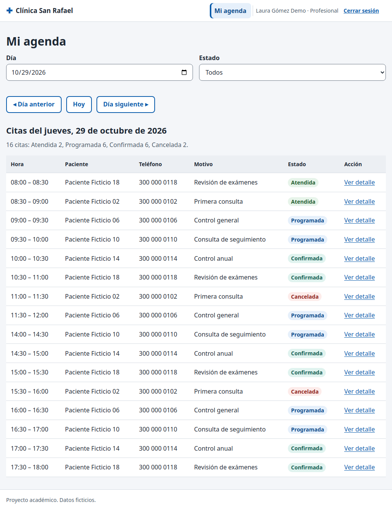

# CP-22: El profesional solo ve su agenda

| Campo | Valor |
| --- | --- |
| Tipo | Seguridad |
| Requisito | RF-10 |
| Responsable | P4 |
| Datos usados | `profesional1@demo.test`; `paciente1@demo.test`; una cita de profesional2. |
| Resultado esperado | Solo aparecen citas de profesional1; la cita ajena no se muestra; el paciente recibe `NO_AUTORIZADO`. |
| Estado | **Aprobado en la réplica local.** Pendiente de repetir en la URL publicada contra Supabase. |

## Pasos

1. Entrar como profesional1: la agenda de hoy debe mostrar exactamente sus citas.
2. Abrir por URL el detalle de una cita de profesional2.
3. Desde la consola, como profesional1, intentar cambiar el estado de esa cita.
4. Entrar como paciente1 y llamar a `miAgenda('2026-10-29')` desde la consola.

## Resultado obtenido

| Comprobación | Resultado | Estado |
| --- | --- | --- |
| Filas en la agenda de hoy | 16 en pantalla = 16 citas de profesional1 en SQL | Pasa |
| Cita ajena por URL | "No encontramos esta cita o no tienes acceso a ella." (no revela si existe) | Pasa |
| Cambiar estado de cita ajena | `NO_AUTORIZADO` (también cubre CP-04 de P2) | Pasa |
| Paciente llama a `mi_agenda` | `NO_AUTORIZADO` | Pasa |
| Paciente abre `admin/` | pantalla "Acceso denegado" | Pasa |
| Paciente con nombre `` en la agenda | se ve como texto; no se ejecuta ningún `alert` | Pasa |

## Captura

## Entorno de ejecución

- **Fecha:** 29/10/2026. **Ejecutó:** P4 (Claude Code, Claude Opus 5.5), con un script de
  Playwright que maneja un Chromium real y compara contra consultas SQL directas.
- **Dónde:** **réplica local**, no el proyecto Supabase. PostgreSQL 15 (Docker) con los scripts
  de P2 en orden (`sql/local/simular_supabase.sql`, `esquema.sql`, `politicas_rls.sql`,
  `sql/local/crear_cuentas_demo.sql`, `datos_prueba.sql` y `datos_pruebas_especiales.sql` de la
  rama `p2/ronda2`), **PostgREST v12.2.3** (la versión de la API de Supabase) y un servidor local
  que sirve las páginas del repositorio y simula Supabase Auth con JWT firmados localmente.
  Las páginas, `supabase-js 2.45.4`, la RLS y las RPC son las reales; lo único simulado es el
  inicio de sesión (sin contraseñas).
- **Por qué local:** P4 no tiene ni pide las contraseñas de las cuentas demo. **Pendiente
  (ronda 3):** repetir en `https://cospino08.github.io/diseno/` con las cuentas reales.
