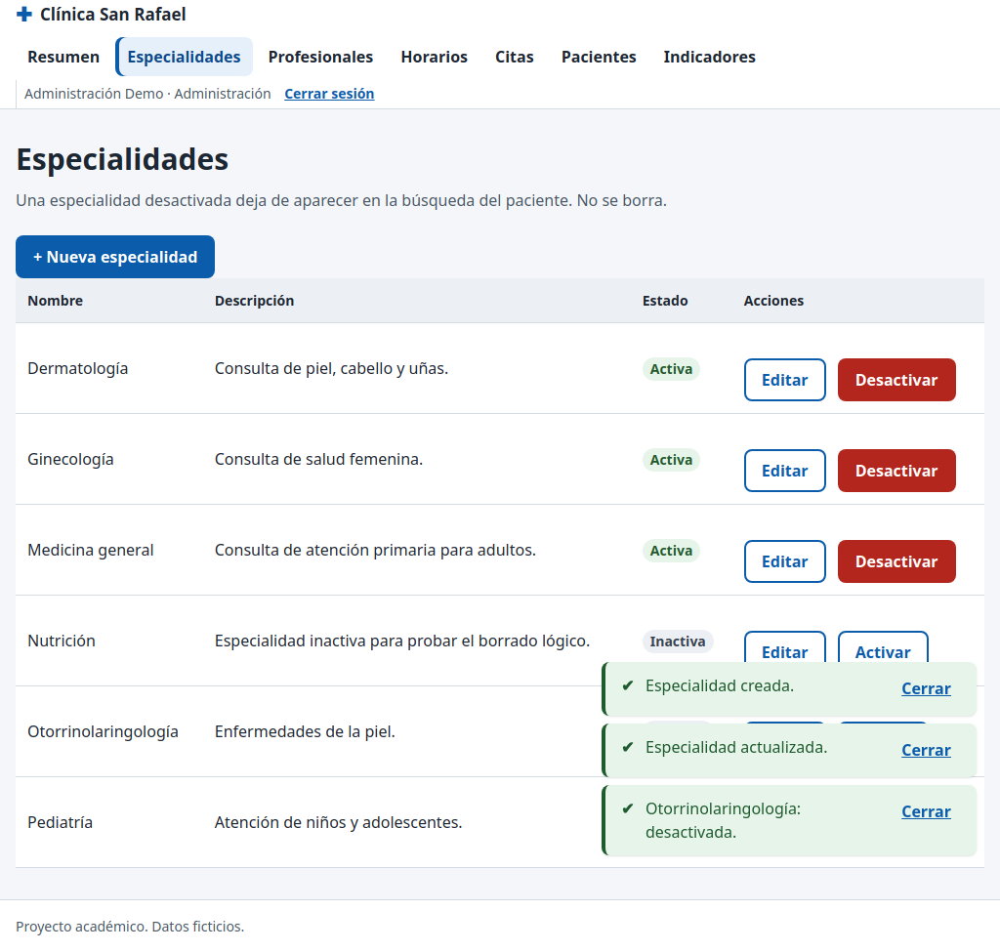

# CP-24: Especialidades: crear, desactivar y rechazo al paciente

| Campo | Valor |
| --- | --- |
| Tipo | Funcional / seguridad |
| Requisito | RF-14, RF-08 |
| Responsable | P4 |
| Datos usados | `admin@demo.test`; `paciente1@demo.test`; especialidad nueva "Otorrinolaringología". |
| Resultado esperado | La especialidad se crea y se desactiva; el repetido se rechaza; el insert del paciente es rechazado. |
| Estado | **Aprobado en la réplica local.** Pendiente de repetir en la URL publicada contra Supabase. |

## Pasos

1. Como admin, en **Especialidades**: crear "Otorrinolaringología".
2. Intentar crear "otorrinolaringología" (mismas letras, otras mayúsculas).
3. Editar su descripción y desactivarla (con confirmación).
4. Como paciente1, desde la consola: `crearEspecialidad({ nombre: 'Hackeada' })`.

## Resultado obtenido

| Comprobación | Resultado | Estado |
| --- | --- | --- |
| Crear | fila nueva en `specialties`, activa | Pasa |
| Nombre repetido | error bajo el campo: "Ya existe una especialidad con ese nombre." (`23505`) | Pasa |
| Editar descripción | guardada | Pasa |
| Desactivar | `activo = false`; botón cambia a "Activar" | Pasa |
| Insert del paciente | `NO_AUTORIZADO` (`42501` de la RLS); "Hackeada" no existe en la base | Pasa |

## Captura

Que la especialidad desactivada no aparezca en la búsqueda del paciente depende de la pantalla de búsqueda de P3 (aún no construida). En la base, `listarEspecialidades()` sin `incluirInactivas` ya filtra `activo = true`, y la RLS solo deja ver las activas al paciente.

## Entorno de ejecución

- **Fecha:** 29/10/2026. **Ejecutó:** P4 (Claude Code, Claude Opus 5.5), con un script de
  Playwright que maneja un Chromium real y compara contra consultas SQL directas.
- **Dónde:** **réplica local**, no el proyecto Supabase. PostgreSQL 15 (Docker) con los scripts
  de P2 en orden (`sql/local/simular_supabase.sql`, `esquema.sql`, `politicas_rls.sql`,
  `sql/local/crear_cuentas_demo.sql`, `datos_prueba.sql` y `datos_pruebas_especiales.sql` de la
  rama `p2/ronda2`), **PostgREST v12.2.3** (la versión de la API de Supabase) y un servidor local
  que sirve las páginas del repositorio y simula Supabase Auth con JWT firmados localmente.
  Las páginas, `supabase-js 2.45.4`, la RLS y las RPC son las reales; lo único simulado es el
  inicio de sesión (sin contraseñas).
- **Por qué local:** P4 no tiene ni pide las contraseñas de las cuentas demo. **Pendiente
  (ronda 3):** repetir en `https://cospino08.github.io/diseno/` con las cuentas reales.
