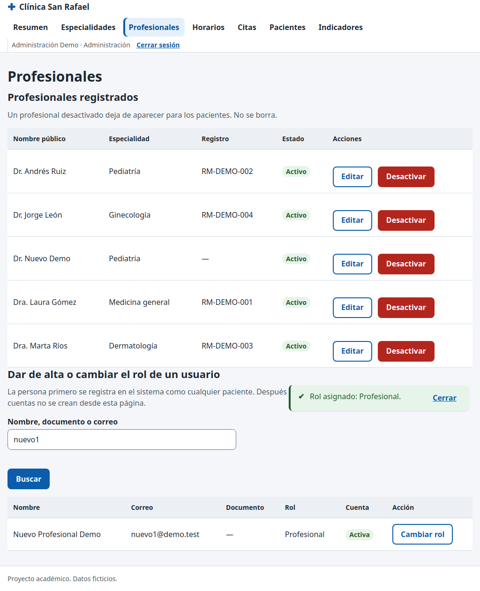

# CP-25: Promover un usuario registrado a profesional

| Campo | Valor |
| --- | --- |
| Tipo | Funcional / seguridad |
| Requisito | RF-15 (plan P10) |
| Responsable | P4 |
| Datos usados | `admin@demo.test`; cuenta nueva `nuevo1@demo.test`; `paciente1@demo.test`. |
| Resultado esperado | Se crea la fila en `professionals`; el paciente recibe `NO_AUTORIZADO`. |
| Estado | **Aprobado en la réplica local.** Pendiente de repetir en la URL publicada contra Supabase. |

## Pasos

1. Simular el registro de `nuevo1@demo.test` (insert en `auth.users` local; el trigger de P2 crea el perfil). En Supabase sería el formulario de registro.
2. Como admin, en **Profesionales → Dar de alta o cambiar el rol**, buscar "nuevo1".
3. Cambiar rol → Profesional, especialidad Pediatría, nombre público "Dr. Nuevo Demo"; confirmar.
4. Buscar la cuenta del propio admin.
5. Como paciente1, desde la consola: `asignarRol(<uuid>, 'admin')`.

## Resultado obtenido

| Comprobación | Resultado | Estado |
| --- | --- | --- |
| Perfil recién registrado | rol `paciente` (aunque nadie lo eligió) | Pasa |
| Tras asignar el rol | `profiles.rol = profesional`; fila en `professionals` con "Dr. Nuevo Demo", Pediatría, activa | Pasa |
| Lista de profesionales | aparece el nuevo profesional | Pasa |
| Cuenta del propio admin | sin botón "Cambiar rol" (la RPC también lo impide) | Pasa |
| Paciente llama a `asignar_rol` | `NO_AUTORIZADO` | Pasa |
| Editar y desactivar el profesional | registro "RM-NUEVO-01" guardado; `activo = false` | Pasa |

## Captura

## Entorno de ejecución

- **Fecha:** 29/10/2026. **Ejecutó:** P4 (Claude Code, Claude Opus 5.5), con un script de
  Playwright que maneja un Chromium real y compara contra consultas SQL directas.
- **Dónde:** **réplica local**, no el proyecto Supabase. PostgreSQL 15 (Docker) con los scripts
  de P2 en orden (`sql/local/simular_supabase.sql`, `esquema.sql`, `politicas_rls.sql`,
  `sql/local/crear_cuentas_demo.sql`, `datos_prueba.sql` y `datos_pruebas_especiales.sql` de la
  rama `p2/ronda2`), **PostgREST v12.2.3** (la versión de la API de Supabase) y un servidor local
  que sirve las páginas del repositorio y simula Supabase Auth con JWT firmados localmente.
  Las páginas, `supabase-js 2.45.4`, la RLS y las RPC son las reales; lo único simulado es el
  inicio de sesión (sin contraseñas).
- **Por qué local:** P4 no tiene ni pide las contraseñas de las cuentas demo. **Pendiente
  (ronda 3):** repetir en `https://cospino08.github.io/diseno/` con las cuentas reales.
