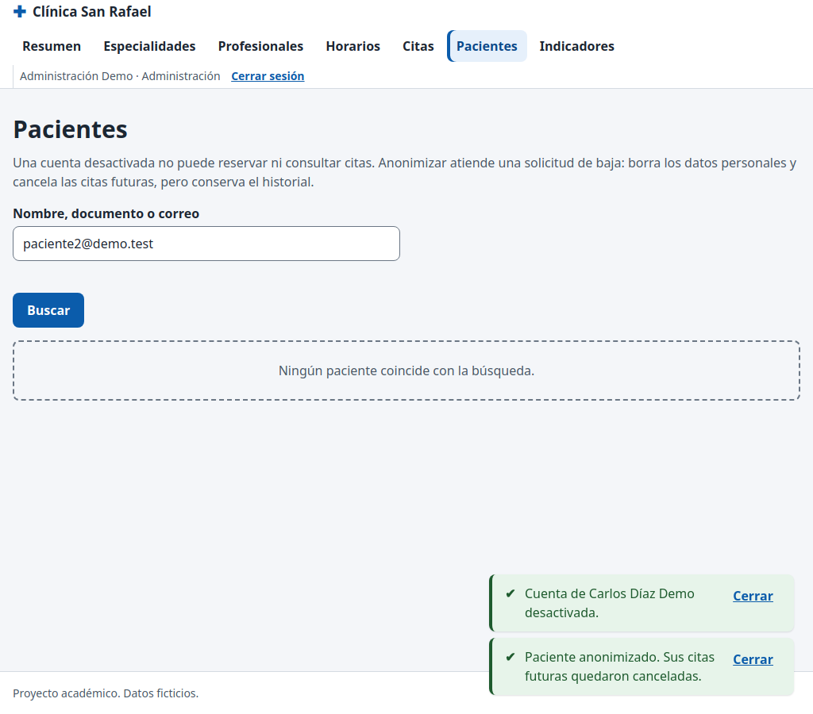

# CP-27: Desactivar y anonimizar un paciente

| Campo | Valor |
| --- | --- |
| Tipo | Funcional / seguridad |
| Requisito | RF-21 (CU-12, plan P13) |
| Responsable | P4 |
| Datos usados | `admin@demo.test`; `paciente2@demo.test` con una cita futura activa. |
| Resultado esperado | Desactivado: `rol_actual()` = null y `reservar_cita` rechazada. Anonimizado: datos reemplazados, cita futura `cancelada` pero conservada. |
| Estado | **Aprobado en la réplica local.** Pendiente de repetir en la URL publicada contra Supabase. |

## Pasos

1. Como admin, en **Pacientes**, buscar `paciente2@demo.test` y **Desactivar** (con confirmación).
2. En otra sesión, como paciente2: `rol_actual()`, `reservarCita(…)` y `franjasDisponibles()`.
3. Como admin, **Anonimizar** a paciente2 (confirmación de acción irreversible).
4. Revisar en SQL su perfil y la cita futura.

## Resultado obtenido

| Comprobación | Resultado | Estado |
| --- | --- | --- |
| Desactivar | `profiles.activo = false`; botón cambia a "Reactivar" | Pasa |
| `rol_actual()` de paciente2 | `null` | Pasa |
| `reservar_cita` de paciente2 | rechazada con `SOLO_PACIENTES` (el contrato la da para un paciente no activo) | Pasa |
| `franjas_disponibles` de paciente2 | lista vacía | Pasa |
| Perfil tras anonimizar | `Paciente anonimizado`, documento y teléfono `null`, inactivo | Pasa |
| Cita futura | sigue existiendo, ahora `cancelada` | Pasa |

## Captura

## Entorno de ejecución

- **Fecha:** 29/10/2026. **Ejecutó:** P4 (Claude Code, Claude Opus 5.5), con un script de
  Playwright que maneja un Chromium real y compara contra consultas SQL directas.
- **Dónde:** **réplica local**, no el proyecto Supabase. PostgreSQL 15 (Docker) con los scripts
  de P2 en orden (`sql/local/simular_supabase.sql`, `esquema.sql`, `politicas_rls.sql`,
  `sql/local/crear_cuentas_demo.sql`, `datos_prueba.sql` y `datos_pruebas_especiales.sql` de la
  rama `p2/ronda2`), **PostgREST v12.2.3** (la versión de la API de Supabase) y un servidor local
  que sirve las páginas del repositorio y simula Supabase Auth con JWT firmados localmente.
  Las páginas, `supabase-js 2.45.4`, la RLS y las RPC son las reales; lo único simulado es el
  inicio de sesión (sin contraseñas).
- **Por qué local:** P4 no tiene ni pide las contraseñas de las cuentas demo. **Pendiente
  (ronda 3):** repetir en `https://cospino08.github.io/diseno/` con las cuentas reales.
