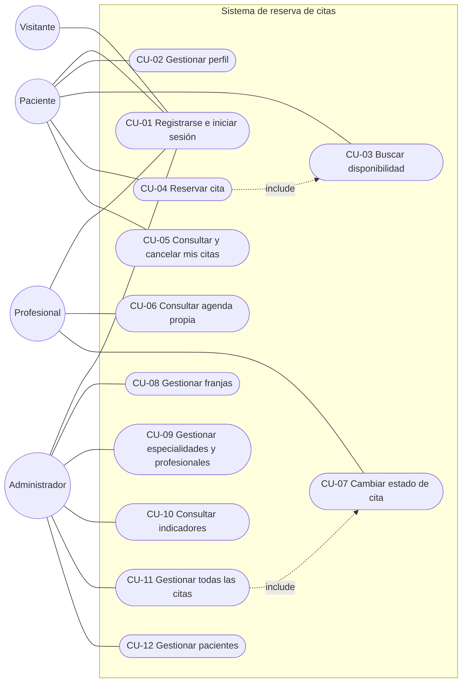

# 7. Casos de uso

Responde a la sección 7.3 del enunciado: diagrama general y mínimo 8 casos detallados con
precondiciones, flujo principal, alternativas, excepciones y postcondiciones.

## 7.1 Diagrama general

Mermaid no tiene un diagrama de casos de uso UML; se representa con un flujograma donde los
óvalos son casos de uso y las líneas punteadas son relaciones `«include»`. Para el documento
final se puede redibujar en notación UML con cualquier herramienta gratuita.

## 7.2 Resumen

| CU | Nombre | Actor principal | Requisitos |
| --- | --- | --- | --- |
| CU-01 | Registrarse e iniciar sesión | Visitante, todos | RF-01, RF-02, RF-03 |
| CU-02 | Gestionar perfil | Paciente | RF-04, RF-05 |
| CU-03 | Buscar disponibilidad | Paciente | RF-07, RF-08 |
| CU-04 | Reservar cita | Paciente | RF-05, RF-06, RF-13, RF-20 |
| CU-05 | Consultar y cancelar mis citas | Paciente | RF-09, RF-12, RF-13 |
| CU-06 | Consultar agenda propia | Profesional | RF-10 |
| CU-07 | Cambiar estado de cita | Profesional | RF-11, RF-13 |
| CU-08 | Gestionar franjas | Admin | RF-16, RF-17 |
| CU-09 | Gestionar especialidades y profesionales | Admin | RF-14, RF-15 |
| CU-10 | Consultar indicadores | Admin | RF-19 |
| CU-11 | Gestionar todas las citas | Admin | RF-18, RF-13 |
| CU-12 | Gestionar pacientes | Admin | RF-21 |

---

## CU-01 Registrarse e iniciar sesión

| Elemento | Descripción |
| --- | --- |
| Actor | Visitante (registro); Paciente, Profesional, Admin (inicio de sesión) |
| Historia | Como visitante, quiero crear una cuenta para reservar citas sin llamar a la clínica. |
| Precondiciones | El usuario no tiene sesión activa. |
| Flujo principal | 1. El visitante abre "Registrarse". 2. Escribe nombres, correo y contraseña. 3. El sistema valida el formato en el cliente. 4. Supabase Auth crea el usuario. 5. El trigger crea el perfil con rol `paciente`. 6. El sistema muestra éxito y lleva al inicio de sesión (o inicia sesión directamente si no se exige confirmación de correo). 7. El usuario inicia sesión con correo y contraseña. 8. El sistema consulta `rol_actual()` y lo lleva a su página de inicio. |
| Alternativas | 2a. Olvidó la contraseña: elige "Recuperar contraseña", escribe su correo y el sistema muestra una instrucción genérica (RF-03). 8a. Rol `profesional`: va a la agenda. 8b. Rol `admin`: va al resumen. 8c. `rol_actual()` devuelve `null`: "Cuenta desactivada". |
| Excepciones | 3a. Datos inválidos: mensaje junto al campo. 4a. Correo ya registrado: mensaje sin revelar datos de la cuenta. 7a. Credenciales incorrectas: "Correo o contraseña incorrectos". 7b. Error de red: estado de error con opción de reintentar. |
| Postcondiciones | Existe el usuario en `auth.users` y su fila en `profiles` con rol `paciente`. Tras iniciar sesión, hay una sesión válida. |

## CU-02 Gestionar perfil

| Elemento | Descripción |
| --- | --- |
| Actor | Paciente |
| Historia | Como paciente, quiero mantener mis datos actualizados para que la clínica pueda contactarme. |
| Precondiciones | El paciente ha iniciado sesión. |
| Flujo principal | 1. El paciente abre "Perfil". 2. El sistema muestra nombres, documento, teléfono y fecha de nacimiento. 3. El paciente edita los campos. 4. El sistema valida en el cliente (documento y teléfono con formato, fecha de nacimiento no futura). 5. Se guarda el perfil. 6. Mensaje de éxito. |
| Alternativas | 1a. Primer ingreso con perfil incompleto: el sistema abre el perfil automáticamente antes de permitir reservar. |
| Excepciones | 4a. Datos inválidos: mensaje por campo. 5a. Documento ya usado por otro usuario (`23505`): mensaje de conflicto. 5b. Formato inválido (`23514`): mensaje por campo. 5c. Intento de cambiar `rol` desde la consola: `42501` (CP-06). |
| Postcondiciones | El perfil queda actualizado; el rol no cambia. |

## CU-03 Buscar disponibilidad

| Elemento | Descripción |
| --- | --- |
| Actor | Paciente |
| Historia | Como paciente, quiero consultar franjas disponibles por especialidad para reservar una cita compatible con mi horario. |
| Precondiciones | El paciente ha iniciado sesión. Existen especialidades y franjas publicadas. |
| Flujo principal | 1. El paciente abre "Buscar". 2. El sistema carga las especialidades activas. 3. El paciente elige especialidad y fecha. 4. El sistema carga los profesionales activos de esa especialidad. 5. El paciente pulsa "Buscar". 6. El sistema llama a `franjas_disponibles` y muestra franjas futuras y libres con hora y profesional. |
| Alternativas | 3a. Elige también un profesional concreto: se filtra por él. 3b. No elige fecha: se muestran los próximos 30 días. |
| Excepciones | 6a. Sin franjas: estado vacío con sugerencia de otra fecha. 6b. Error de red: estado de error. 6c. Sesión expirada: redirige al inicio de sesión. |
| Postcondiciones | El paciente ve solo franjas realmente disponibles. No se modifica ningún dato. |

## CU-04 Reservar cita

| Elemento | Descripción |
| --- | --- |
| Actor | Paciente |
| Historia | Como paciente, quiero reservar una franja libre y recibir confirmación inmediata. |
| Precondiciones | El paciente ha iniciado sesión, su perfil está completo y existen horarios publicados (incluye CU-03). |
| Flujo principal | 1. El paciente elige una franja del resultado de CU-03. 2. El sistema muestra el resumen (fecha, hora, profesional, especialidad) y un campo de motivo breve con el aviso de no escribir información clínica. 3. El paciente confirma. 4. El sistema llama a `reservar_cita`. 5. La base bloquea la franja, verifica que sea activa, futura y libre, y crea la cita en estado `programada`. 6. El sistema muestra la confirmación y el enlace a "Mis citas". |
| Alternativas | 3a. El paciente cancela la confirmación: vuelve a la búsqueda sin cambios. |
| Excepciones | 5a. Otra persona reservó la franja antes: `FRANJA_OCUPADA`; el sistema informa el conflicto y actualiza la disponibilidad. 5b. La franja ya pasó: `FRANJA_PASADA`. 5c. Perfil incompleto: `PERFIL_INCOMPLETO`, se abre el perfil. 5d. Franja desactivada o de un profesional inactivo: `FRANJA_NO_EXISTE`. 5e. Usuario sin rol paciente: `SOLO_PACIENTES`. 5f. Motivo de más de 200 caracteres: `DATOS_INVALIDOS`. |
| Postcondiciones | La reserva queda vinculada al usuario; existe una sola cita activa para la franja; `status_history` tiene la fila de creación; la franja no aparece en nuevas búsquedas; se muestra confirmación. |

## CU-05 Consultar y cancelar mis citas

| Elemento | Descripción |
| --- | --- |
| Actor | Paciente |
| Historia | Como paciente, quiero ver mis citas y cancelar las que no podré atender para liberar el horario. |
| Precondiciones | El paciente ha iniciado sesión. |
| Flujo principal | 1. El paciente abre "Mis citas". 2. El sistema llama a `mis_citas` y lista sus citas con fecha, hora, profesional, especialidad y estado, de la más reciente a la más antigua. 3. El paciente elige "Cancelar" en una cita con `puede_cancelar = true`. 4. El sistema pide confirmación. 5. El paciente confirma. 6. El sistema llama a `cancelar_cita`. 7. La cita pasa a `cancelada` y se registra el historial. 8. Mensaje de éxito; la lista se actualiza. |
| Alternativas | 2a. Sin citas: estado vacío con enlace a "Buscar". 2b. Cita con `cancelado_por` distinto de `paciente`: se muestra "Cancelada por la institución". |
| Excepciones | 6a. Faltan menos de 2 h: `FUERA_DE_PLAZO`. 6b. La cita ya está en un estado final: `TRANSICION_INVALIDA`. 6c. Se manipula el ID para cancelar una cita ajena: `NO_AUTORIZADO`. |
| Postcondiciones | La cita queda `cancelada` con `cancelled_at` y `cancelado_por = 'paciente'`; la franja queda disponible para otra reserva; `status_history` registra al paciente como autor. |

## CU-06 Consultar agenda propia

| Elemento | Descripción |
| --- | --- |
| Actor | Profesional |
| Historia | Como profesional, quiero ver mi agenda del día actualizada para organizar la atención. |
| Precondiciones | El usuario ha iniciado sesión con rol `profesional` y está activo. |
| Flujo principal | 1. El profesional abre "Agenda". 2. El sistema llama a `mi_agenda` con la fecha de hoy. 3. Se listan sus citas con hora, nombre y teléfono del paciente, motivo y estado. 4. El profesional cambia la fecha o el rango (máximo 31 días) para ver otros días. 5. Abre el detalle de una cita con su historial de estados. |
| Alternativas | 3a. Día sin citas: estado vacío. |
| Excepciones | 2a. Usuario que no es profesional activo: `NO_AUTORIZADO`, vista de acceso denegado. 2b. Rango mayor a 31 días: `DATOS_INVALIDOS`. 2c. Error de red: estado de error. |
| Postcondiciones | El profesional ve solo sus citas; ningún dato cambia. |

## CU-07 Cambiar estado de cita

| Elemento | Descripción |
| --- | --- |
| Actor | Profesional (también Admin mediante CU-11) |
| Historia | Como profesional, quiero registrar si el paciente asistió para que la clínica tenga datos reales de la atención. |
| Precondiciones | El profesional ha iniciado sesión y la cita le pertenece. |
| Flujo principal | 1. Desde el detalle de la cita, el sistema lee `transiciones_validas` y muestra solo los estados permitidos desde el estado actual. 2. El profesional elige el nuevo estado (por ejemplo, `confirmada`) y, si quiere, escribe una observación administrativa (máximo 500 caracteres). 3. El sistema pide confirmación. 4. Se llama a `cambiar_estado_cita`. 5. La base valida propiedad y transición, actualiza el estado y escribe `status_history`. 6. Mensaje de éxito. |
| Alternativas | 2a. Elige `atendida` o `no_asistio` sobre una cita `confirmada` cuya hora ya empezó. 2b. Elige `cancelada`: la franja queda libre. |
| Excepciones | 5a. Transición no permitida (p. ej., `atendida` → `programada`): `TRANSICION_INVALIDA`. 5b. Cita de otro profesional: `NO_AUTORIZADO`. 5c. Marcar `atendida`/`no_asistio` antes de la hora de inicio: `ANTES_DE_HORA`. |
| Postcondiciones | La cita tiene el nuevo estado y el historial registra al profesional como autor. |

## CU-08 Gestionar franjas

| Elemento | Descripción |
| --- | --- |
| Actor | Administrador |
| Historia | Como administrador, quiero publicar los horarios de cada profesional en bloque para no crearlos uno por uno. |
| Precondiciones | El admin ha iniciado sesión; el profesional existe y está activo. |
| Flujo principal | 1. El admin abre "Horarios". 2. Elige profesional, fecha, hora de inicio, hora de fin y duración de la franja. 3. El sistema valida en el cliente (fin > inicio, fecha no pasada, duración entre 10 y 240 minutos). 4. Se llama a `generar_franjas`. 5. La base crea las franjas (todo o nada). 6. El sistema muestra cuántas se crearon y las lista. |
| Alternativas | 6a. El admin edita o desactiva una franja sin cita activa: el cambio se guarda. |
| Excepciones | 5a. Alguna franja se cruza con otra activa del mismo profesional: `HORARIO_SUPERPUESTO`, no se crea ninguna. 5b. Fecha pasada: `FRANJA_PASADA`. 5c. Profesional inactivo o duración fuera de rango: `DATOS_INVALIDOS`. 6b. Intento de mover o desactivar una franja con cita activa: `FRANJA_CON_CITA`; se indica cancelar primero la cita (CU-11). |
| Postcondiciones | Las franjas quedan publicadas y visibles en CU-03; nunca hay dos franjas activas superpuestas por profesional. |

## CU-09 Gestionar especialidades y profesionales

| Elemento | Descripción |
| --- | --- |
| Actor | Administrador |
| Historia | Como administrador, quiero mantener el catálogo de especialidades y profesionales para que los pacientes vean solo opciones vigentes. |
| Precondiciones | El admin ha iniciado sesión. Para promover a un profesional, la persona ya se registró (CU-01). |
| Flujo principal | 1. El admin abre "Especialidades" y crea o edita una (nombre, descripción). 2. Activa o desactiva especialidades. 3. Abre "Profesionales", busca un usuario registrado en `profiles` y le asigna el rol `profesional`, una especialidad y un nombre público con `asignar_rol`. 4. Activa o desactiva profesionales. 5. Mensaje de éxito en cada acción. |
| Alternativas | 3a. Asigna el rol `admin` a otro usuario. |
| Excepciones | 1a. Nombre de especialidad repetido (`23505`): mensaje de conflicto. 3b. Un no admin llama a `asignar_rol`: `NO_AUTORIZADO`. 3c. Especialidad faltante o inactiva: `DATOS_INVALIDOS`. 3d. El admin intenta cambiar su propio rol: rechazado. |
| Postcondiciones | Los catálogos quedan actualizados; los elementos desactivados no aparecen al paciente pero se conservan (borrado lógico). |

## CU-10 Consultar indicadores

| Elemento | Descripción |
| --- | --- |
| Actor | Administrador |
| Historia | Como administrador, quiero ver cuántas citas hay por estado y por especialidad en un periodo para decidir cuántas franjas abrir. |
| Precondiciones | El admin ha iniciado sesión. |
| Flujo principal | 1. El admin abre "Indicadores". 2. Elige un rango de fechas y la agrupación (día, semana o mes). 3. El sistema llama a `indicadores_citas`. 4. Se muestran los totales por estado, por especialidad y por periodo. |
| Alternativas | 4a. Sin citas en el rango: estado vacío. |
| Excepciones | 3a. Un no admin: `NO_AUTORIZADO`. 3b. Fecha final anterior a la inicial: `DATOS_INVALIDOS`. 3c. Error de red: estado de error. |
| Postcondiciones | Ningún dato cambia; los valores coinciden con un conteo SQL directo (CP-15). |

## CU-11 Gestionar todas las citas

| Elemento | Descripción |
| --- | --- |
| Actor | Administrador |
| Historia | Como administrador, quiero ver y gestionar cualquier cita para atender cancelaciones institucionales. |
| Precondiciones | El admin ha iniciado sesión. |
| Flujo principal | 1. El admin abre "Citas". 2. Filtra por rango de fechas, profesional o estado (`citas_admin`). 3. Elige una cita y un nuevo estado (incluye CU-07). 4. Confirma. 5. La base valida la transición y registra al admin en el historial. |
| Alternativas | 3a. Cancela la cita para poder mover la franja (CU-08). |
| Excepciones | 5a. Transición no permitida: `TRANSICION_INVALIDA`. |
| Postcondiciones | La cita queda con el nuevo estado; el paciente lo ve en "Mis citas"; el historial guarda la acción del admin. |

## CU-12 Gestionar pacientes

| Elemento | Descripción |
| --- | --- |
| Actor | Administrador |
| Historia | Como administrador, quiero desactivar cuentas o anonimizar a un paciente que pide la baja sin perder la trazabilidad de la agenda. |
| Precondiciones | El admin ha iniciado sesión. |
| Flujo principal | 1. El admin abre "Pacientes". 2. El sistema lista los perfiles con rol `paciente`. 3. El admin corrige datos de contacto de un paciente si es necesario. 4. Desactiva o reactiva la cuenta con `cambiar_activo_perfil`. 5. Mensaje de éxito. |
| Alternativas | 4a. El paciente pide la baja: el admin confirma y ejecuta `anonimizar_paciente`. |
| Excepciones | 4b. El admin intenta desactivarse a sí mismo: `DATOS_INVALIDOS`. 4c. Se intenta anonimizar a un usuario que no es paciente: `DATOS_INVALIDOS`. 4d. Un no admin: `NO_AUTORIZADO`. |
| Postcondiciones | Una cuenta desactivada no puede usar el sistema (`rol_actual()` = `null`). Un paciente anonimizado no tiene datos personales, sus citas futuras quedan canceladas y su historial se conserva. |
