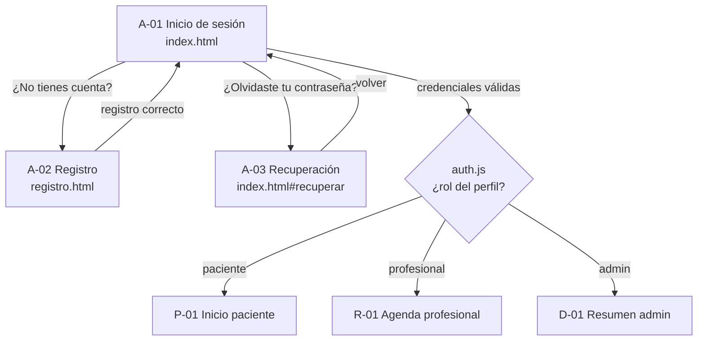
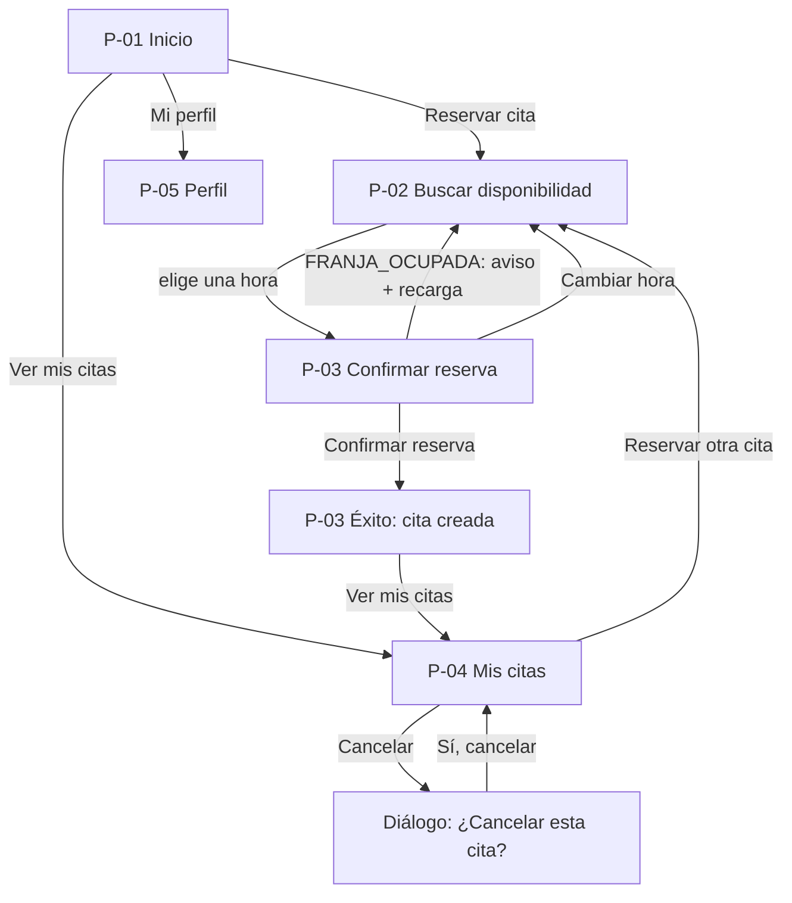
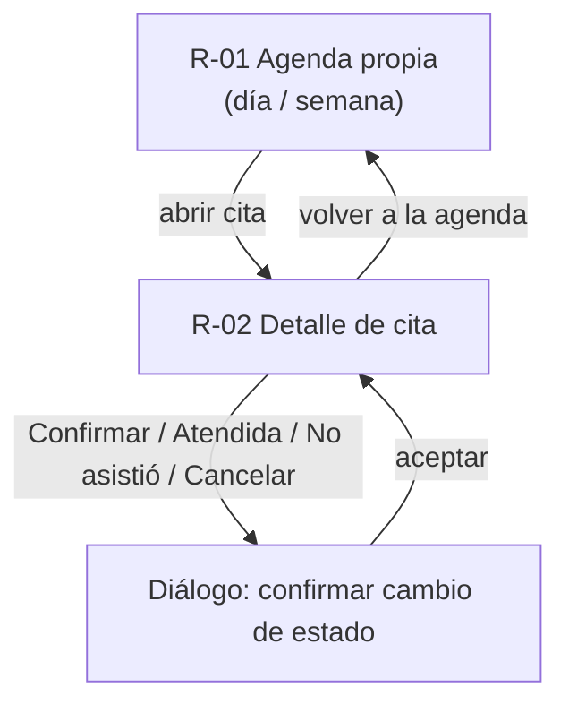
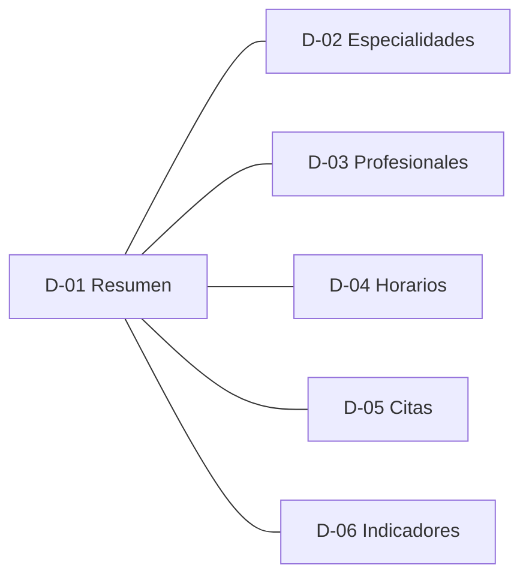

# Mapa de navegación y wireframes

Producto de la sección 8.2 del enunciado ("Mapa de navegación por rol" y "Wireframes de las
pantallas principales antes de programar"). Responsable: P3. Las pantallas del profesional
y del administrador las construye P4. Aquí van en baja fidelidad para que el mapa quede
completo, y P4 puede ajustarlas.

| Archivo | Contenido |
| --- | --- |
| `README.md` (este) | Inventario de pantallas, mapa de navegación por rol, conteo de pasos de la reserva y convenciones. |
| [`acceso.md`](acceso.md) | A-01 a A-04: inicio de sesión, registro, recuperación y cierre de sesión. |
| [`paciente.md`](paciente.md) | P-01 a P-05: inicio, buscar, confirmar reserva, mis citas y perfil. |
| [`profesional_admin.md`](profesional_admin.md) | R-01 a R-02 y D-01 a D-06 (profesional y administración). |
| [`estados.md`](estados.md) | Los cinco estados de interfaz (cargando, vacío, error, acceso denegado y éxito) y cómo se ven. |

Los wireframes son **mockups ASCII** dibujados a **360 px de ancho**, el caso más estrecho
que exige RNF-04. En pantallas anchas, el contenido se centra con un ancho máximo y las
listas pasan a dos columnas. No se usan imágenes, para que el texto se pueda revisar en el
Pull Request.

---

## 1. Inventario de pantallas

| ID | Pantalla | Archivo | Rol | Dueño | Datos (contrato) |
| --- | --- | --- | --- | --- | --- |
| A-01 | Inicio de sesión | `index.html` | público | P3 | `auth.signInWithPassword` |
| A-02 | Registro | `registro.html` | público | P3 | `auth.signUp` (el trigger crea el perfil como `paciente`) |
| A-03 | Recuperación de contraseña | `index.html#recuperar` | público | P3 | `auth.resetPasswordForEmail`, `auth.updateUser` |
| A-04 | Cierre de sesión | botón en el encabezado | todos | P3 | `auth.signOut` |
| P-01 | Inicio del paciente | `paciente/index.html` | paciente | P3 | `profiles` (propio), próximas citas |
| P-02 | Buscar disponibilidad | `paciente/buscar.html` | paciente | P3 | `specialties`, profesionales públicos, `franjas_disponibles` |
| P-03 | Confirmar reserva | `paciente/reservar.html` | paciente | P3 | `reservar_cita` |
| P-04 | Mis citas (y cancelar) | `paciente/mis-citas.html` | paciente | P3 | `appointments` (RLS: solo las propias), `cancelar_cita` |
| P-05 | Perfil | `paciente/perfil.html` | paciente | P3 | `profiles` (columnas permitidas) |
| R-01 | Agenda propia | `profesional/agenda.html` | profesional | P4 | `mi_agenda` |
| R-02 | Detalle y cambio de estado | `profesional/cita.html` | profesional | P4 | `cambiar_estado_cita` |
| D-01 | Resumen | `admin/resumen.html` | admin | P4 | `indicadores_citas` |
| D-02 | Especialidades | `admin/especialidades.html` | admin | P4 | `specialties` |
| D-03 | Profesionales | `admin/profesionales.html` | admin | P4 | `professionals`, `asignar_rol` |
| D-04 | Horarios | `admin/horarios.html` | admin | P4 | `generar_franjas`, `schedules` |
| D-05 | Citas | `admin/citas.html` | admin | P4 | `appointments`, `cancelar_cita` |
| D-06 | Indicadores | `admin/indicadores.html` | admin | P4 | `indicadores_citas` |

Esto cubre todas las pantallas mínimas de la sección 8.3 del enunciado.

---

## 2. Mapa de navegación por rol

### 2.1 Acceso (común a los tres roles)

- El registro siempre crea un **paciente**. El rol lo asigna la base de datos (trigger,
  plan P4), nunca el formulario. Para que alguien sea profesional o admin, un admin lo
  promueve con `asignar_rol`.
- **Sesión expirada** (desde cualquier pantalla privada): `onAuthStateChange` recibe
  `SIGNED_OUT` y redirige a `index.html?motivo=sesion-expirada`. A-01 muestra "Tu sesión
  expiró. Inicia sesión de nuevo".
- **Cerrar sesión** (A-04) está en el encabezado de todas las pantallas privadas y vuelve
  a A-01 con "Cerraste sesión".

### 2.2 Paciente

**Regla de perfil completo:** si el perfil no tiene documento, teléfono o fecha de
nacimiento, cualquier pantalla del paciente redirige a **P-05** con el aviso "Completa tu
perfil para poder reservar". Lo hace `auth.js` al cargar la página. La base de datos
también lo exige: `reservar_cita` devuelve `PERFIL_INCOMPLETO`.

El menú del paciente (encabezado) siempre muestra: **Inicio · Reservar cita · Mis citas ·
Mi perfil · Cerrar sesión**.

### 2.3 Profesional (P4)

R-02 muestra **solo** los botones de las transiciones válidas para el estado actual (tabla
P6 del plan). Es por usabilidad: quien bloquea las transiciones inválidas es el trigger.

### 2.4 Administrador (P4)

El menú lateral (o superior en móvil) enlaza las seis pantallas entre sí.

### 2.5 Qué pasa si alguien entra a una pantalla que no le corresponde

| Situación | Qué hace la interfaz | Qué lo impide de verdad |
| --- | --- | --- |
| Sin sesión, abre `paciente/mis-citas.html` | Redirige a A-01 con "Inicia sesión para continuar". | RLS: sin `auth.uid()`, ninguna política devuelve filas. |
| Paciente abre `admin/resumen.html` | Muestra el estado **Acceso denegado** con un enlace a su inicio. | `indicadores_citas` verifica `rol_actual() = 'admin'` y lanza `NO_AUTORIZADO`. |
| Paciente cambia el id de la URL de una cita | La lista o el detalle salen vacíos. | RLS de `appointments`: `patient_id = auth.uid()`. |

La guarda de página (`protegerPagina` en `auth.js`) **solo mejora la experiencia**. La
seguridad la dan las políticas y las RPC (sección 11.2 del enunciado).

---

## 3. Reserva en máximo 5 pasos (RNF-03, CP-16)

Se cuenta como "paso" cada acción del usuario que lo hace avanzar en el flujo, a partir de
la pantalla de inicio del paciente, ya con la sesión iniciada:

| Paso | Pantalla | Acción del usuario |
| --- | --- | --- |
| 1 | P-01 Inicio | Pulsa **Reservar cita**. |
| 2 | P-02 Buscar | Elige especialidad y fecha (el profesional es opcional) y pulsa **Buscar**. |
| 3 | P-02 Buscar | Pulsa una **hora disponible**. |
| 4 | P-03 Confirmar | Revisa el resumen, escribe el motivo si quiere (opcional) y pulsa **Confirmar reserva**. |
| — | P-03 Éxito | Ve la confirmación. No requiere acción. |

**Total: 4 pasos**, uno menos que el máximo de 5. Hay margen por si el usuario quiere
filtrar también por profesional.

Para que el conteo se cumpla:

- La fecha de búsqueda viene **por defecto en hoy**. Si hoy no hay franjas, la pantalla lo
  dice y ofrece "Ver el día siguiente".
- El motivo es **opcional**, así que no agrega un paso obligatorio.
- No se pide volver a escribir la contraseña ni los datos del perfil.

---

## 4. Convenciones de interfaz (aplican a P3 y P4)

| Tema | Convención | Por qué |
| --- | --- | --- |
| Estructura | `header` (marca, menú y cerrar sesión), `main` con un solo `h1`, `footer`. Enlace "Saltar al contenido" como primer elemento enfocable. | HTML semántico y navegación por teclado (11.2). |
| Formularios | Cada control tiene `<label for>`. Los errores van debajo del campo, enlazados con `aria-describedby`, y el campo recibe `aria-invalid="true"`. Al enviar con errores, el foco pasa al primer campo inválido. | Etiquetas claras y prevención de errores (8.2). |
| Botones | Un solo botón primario por pantalla. Las acciones destructivas (cancelar cita) usan el estilo `peligro` y piden confirmación. | Jerarquía visual y confirmación de acciones relevantes (5.2). |
| Mensajes | Siempre en español claro y con la acción siguiente ("Elige otra hora"). Nunca se muestra el texto técnico de Supabase. Ver `assets/js/ui/mensajes.js`. | Mensajes claros (5.2). |
| Estados | Toda zona que carga datos usa los 5 estados de [`estados.md`](estados.md). | Estados de interfaz (8.2). |
| Fechas y horas | Formato `jue 29 oct 2026` y `08:30` (24 h), en hora de Bogotá (C8 del plan). | Evita ambigüedad AM/PM. |
| Estados de cita | Se muestran como etiqueta de color **con texto**: Programada, Confirmada, Atendida, Cancelada, No asistió. Nunca solo con color. | El color no puede ser el único indicador (WCAG 1.4.1). |
| Datos de la base | Solo con `textContent` y `createElement`. Nunca `innerHTML`. | Evitar XSS (8.2, CP-18). |
| Ancho mínimo | 360 px sin desplazamiento horizontal. Las tablas se convierten en tarjetas en pantallas estrechas. | RNF-04, CP-05. |
